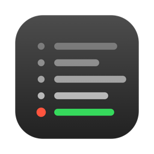
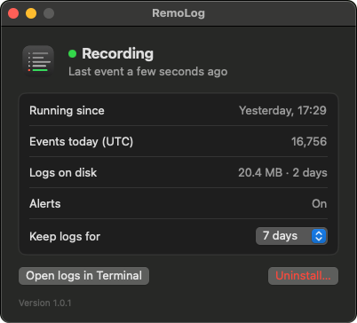

<p align="center">
  
</p>

<h1 align="center">RemoLog</h1>

<p align="center">
  <b>Born out of paranoia.</b><br>
  RemoLog keeps a record macOS doesn't: which program moved, renamed or deleted a file on
  your Mac.
</p>

<p align="center">
  <a href="https://github.com/okoker/remolog/releases/latest"><b>Download RemoLog</b></a>
  &nbsp;·&nbsp; macOS 15 or later &nbsp;·&nbsp; Apple silicon
</p>

<p align="center">
  
</p>

## Why

A file vanishes. Did you bin it by mistake? Did an app, a sync service or an update
remove it? macOS can't tell you. A move to the Bin is just a rename into a hidden
folder, and nothing on the Mac, not its system log and not the Bin itself, notes which
program did it.

RemoLog notes it. It keeps a week of your Mac's file activity, so when something goes
missing you can look up what took it, and when.

## What you can find out

| You want to know | Without RemoLog | With RemoLog |
|---|---|---|
| Where did my file go? | Nothing records which program moved it. | The move: from where, to where, and the program. |
| Which app deleted these files? | Nothing records which program. | Each deletion, and the program that made it. |
| What replaced my file with another version? | Nothing records which program. | The swap onto the old file, and the program. |
| What did that installer change? | `/var/log/install.log` says the package and its scripts ran, and `pkgutil --files` lists the files it shipped. Neither says what the scripts did. | Every file it moved into place or deleted, and every owner or permission it changed, with the program. |
| What did it set up to run in the background? | A "Background Items Added" notice, which doesn't always appear. `sudo sfltool dumpbtm` lists what's there now, with no history. | Each item added or removed, when, and what it runs. |
| What did the uninstaller actually remove? | Nothing records which program. | Each file it deleted or moved to the Bin. |
| Did anyone use `sudo` while I was away? | macOS's own log has it, for hours to days. | Each `sudo`: who, as whom, the command, and whether it worked. |
| Was my Mac unlocked while I was away? | macOS's own log has it, buried among thousands of other messages, for hours to days. | Each lock and unlock, with its time. |
| Who changed the permissions on my private files? | Nothing records which program. | The new permissions or owner, and the program. |
| What non-Apple software touched my files? | Nothing records it. | Every record says whether its program is Apple's own. |

RemoLog sees files moved, deleted or given new permissions, not files simply written:
a file an installer's script writes fresh won't show. Switching an item off or on in
System Settings › Login Items leaves no record either.

## What it records

- Files moved, renamed, deleted, copied or linked, and the program that did it. A move
  to the Bin is a move, so it shows up too.
- Changes to a file's owner, permissions or flags.
- Files that iCloud Drive and other cloud folders download or update.
- Logins, logouts, screen locks and unlocks, `sudo` and `su`.
- Apps adding or removing something that runs in the background.

It does not record what is inside your files, files being written, opened or read, or
anything on the network.

## Looking things up

Each record is one line of JSON. Ask the log what went to the Bin, keeping four of each
record's fields:

```sh
zcat -f /var/log/remo_logs/*.jsonl* |
  jq 'select(.dst? // "" | test("/\\.Trash/")) | {t, exe, src, dst}'
```

```json
{
  "t": "2026-11-22T14:02:11.483920Z",
  "exe": "/System/Library/CoreServices/Finder.app/Contents/MacOS/Finder",
  "src": "/Users/you/Documents/report.pdf",
  "dst": "/Users/you/.Trash/report.pdf"
}
```

Finder moved `report.pdf` from Documents to the Bin at 14:02:11 (times are UTC). The
full record also has the account the program ran as, its process numbers, whether it is
Apple's own, and over twenty more fields.

A few more. Where `report.pdf` went:

```sh
zcat -f /var/log/remo_logs/*.jsonl* | grep -F 'report.pdf' |
  jq -c 'select(.op == "rename") | {t, exe, src, dst}'
```

What was set up to run in the background, and what it runs:

```sh
zcat -f /var/log/remo_logs/*.jsonl* |
  jq -c 'select(.op | startswith("btm_")) | {t, op, btm_type, item_url, exec_path}'
```

Every `sudo`, and whether it worked:

```sh
zcat -f /var/log/remo_logs/*.jsonl* |
  jq -c 'select(.op == "sudo") | {t, from_username, to_username, command, success}'
```

## How it works

- **The recorder** runs in the background from the moment your Mac starts. It reads the
  stream of file activity that macOS gives security software (Apple's Endpoint Security,
  through `eslogger`, a tool built into macOS), keeps the 30 or so fields that matter
  from each event, and adds them to the day's log.
- **The check** runs every 5 minutes. It stays quiet while all is well and sends a
  notification when that changes.
- **The window** shows whether RemoLog is recording. It also sets how long logs are kept,
  opens them in Terminal, fixes what it can, and uninstalls.

## Requirements

- A Mac with Apple silicon (M1 or later). Intel Macs are not supported yet.
- macOS 15 Sequoia or later.

## Install

1. Download `RemoLog-<version>.pkg` from [Releases](https://github.com/okoker/remolog/releases/latest).
2. Open it and follow the installer. It asks for an administrator password.
3. RemoLog opens and asks for two switches:
   - **Full Disk Access**, so it can see file activity. Click Open Settings and switch
     RemoLog on.
   - **Notifications**, so it can tell you if it ever stops. Click Allow.

Then it says Recording, as in the picture above. Close the window: RemoLog keeps
recording, and starts by itself after a restart.

## Update

Download the new `RemoLog-<version>.pkg` and open it. Your logs and settings stay;
recording pauses for a few seconds.

## Uninstall

Open RemoLog from Applications and click **Uninstall…**. Your logs stay in
`/var/log/remo_logs` unless you tick "Also delete all logs".

## Your logs

- One file per day (UTC) in `/var/log/remo_logs`, one JSON record per line. Finished
  days are compressed.
- RemoLog keeps 7 days. **Keep logs for**, in its window, changes that to 14, 30 or 90.
- **Open logs in Terminal**, in its window, opens Terminal there, ready for a search like
  the ones in [Looking things up](#looking-things-up).
- Every account on this Mac can read the logs. Only RemoLog writes to them.

## If something goes wrong

RemoLog checks itself every 5 minutes. It sends a notification if it stops recording,
misses events or runs short of disk space. Open RemoLog to see what's wrong; where it
can, it offers to fix it.

## What it can't do

- An administrator can stop it, without a password, by moving RemoLog out of
  Applications. The log keeps a record that it stopped.
- In a flood of file activity, macOS itself can drop events before RemoLog sees them.
  RemoLog counts what was lost and tells you.
- The logs live on the Mac they describe, so anyone with administrator rights can delete
  or change them.

## Privacy

RemoLog sends nothing anywhere. It has no networking code, no accounts and no analytics.

---

© 2026 Objects Consulting Ltd.
